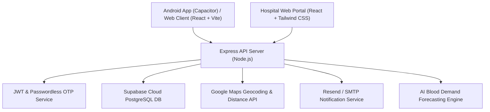

# Blood AI – System Architecture Documentation

## Overview
Blood AI (LifeLink) is an intelligent, real-time blood bank management and donor dispatch system designed for high availability, fault tolerance, and low latency.

## Core Modules
1. **Donor Portal:**
   - Geolocation-based donor matching and emergency blood request feeds.
   - Comprehensive 20+ medical condition health questionnaire with dynamic risk scoring.
   - 90-day cooldown and temporary/permanent eligibility determination.
   - Digital donor card with QR code.

2. **Hospital Dashboard:**
   - Urgent blood request creation with priority flags.
   - 6-Stage Donor Assessment Workflow:
     1. Mark Reached Hospital
     2. Physical Donor Screening (Vitals, Weight, Hemoglobin)
     3. Donor Health Report Review
     4. Eligibility Decision (Approve / Defer / Reject)
     5. Phlebotomy Collection Progress (Whole Blood, Platelets, RBC)
     6. Verification & Digital Certificate Generation
   - Blood Inventory feature completely removed as requested.

3. **Android Application (`com.lifelink.bloodai`):**
   - Capacitor Android native framework.
   - Horizontal mobile title alignment, responsive design, zero letter-breaking.
   - Native notifications, GPS geolocation, and offline state handling.
